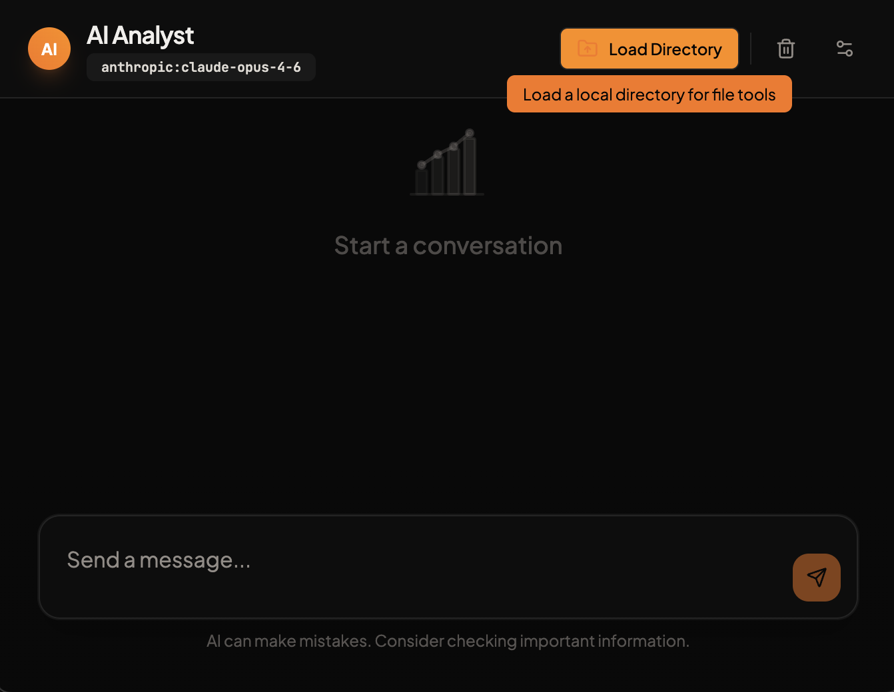

# AI Analyst (Local)

AI Analyst (Local) is a self-hostable, AI-chat application with:

- a **React 19 frontend** for conversational UI, streaming message rendering, artifacts, and local settings
- a **Go backend** for run orchestration, provider routing/proxying, persistence, secrets handling, and integrations

In short: you interact with a browser chat UI, the backend runs tool-capable model sessions, and results are streamed back as SSE in real time.

## What this repository does

This codebase implements an end-to-end agentic assistant platform:

- Multi-provider model orchestration (`OpenAI`, `Anthropic`, `Gemini`, and OpenAI-compatible endpoints)
- Model streaming via a shared event contract (`text`, `tool_calls`, `thinking`, `final`, `error`)
- Automatic tool execution through a registry (`list_files`, `read_file`, `search_files`, `display_table`, `query_bigquery`)
- Artifact creation (`data`, `code`, `image`) and pinned-context reuse in follow-up turns
- Run and thread persistence (MySQL or local JSON fallback)
- Encrypted local secrets + local activation flow
- Optional BigQuery path and provider BigQuery/project controls from UI/server
- Browser-authenticated Atlassian integration for Jira and Confluence through a local Playwright profile

## Repository structure and responsibilities

- `server/`  
  Core runtime backend:
  - chat HTTP API (`/api/threads`, `/api/runs`, `/api/artifacts`, SSE events)
  - provider adapters and agent-loop execution
  - settings/secrets storage, activation checks, proxy routes, tool integrations
  - optional MySQL persistence (thread/run/message/artifact data)
- `providers/`  
  Client-agnostic model interfaces and provider adapters (streaming event adapter layer)
- `hooks/` / `components/`  
  React chat state machine, message rendering, settings, artifact UI
- `tools/`  
  Server-side tools exposed to the model through the tool-calling loop

## Request and execution flow

1. Browser submits a user message from `ChatInput`.
2. Backend receives a run request and creates/loads a thread.
3. `Manager.StartRun` builds conversation context and starts `RunAgentLoop`.
4. Provider adapter streams model events.
5. Tool calls are executed by the tool registry; results are attached and rendered.
6. SSE events are consumed by the frontend and reflected in the UI.
7. Run final output, events, and artifacts are persisted for history and retrieval.

## Supported uploaded file types

Thread uploads are stored as first-class file artifacts. The backend classifies each upload by extension, MIME type, and, for OOXML files, package contents. The upload limit is currently 128 MiB per file. For providers and profiles that support native file or image inputs, the original bytes are attached to the model request. Local extraction sidecars are used for previews, search, fallback context, and provider types that cannot consume a file natively.

Native file support is provider-dependent. OpenAI-compatible profiles in `native_supported` mode can forward inline file bytes broadly, while other providers may accept only specific document or image formats. The UI still stores, previews when possible, and offers downloads for uploaded files even when the active model provider cannot read a file natively.

At a glance, the major supported file types are:

- **PDF:** `.pdf`
- **Images:** `.png`, `.jpg`, `.jpeg`, `.gif`, `.webp`
- **Spreadsheets and tabular data:** `.xlsx`, `.xls`, `.csv`, `.tsv`, `.tab`; spreadsheet cards also recognize `.ods` and `.numbers`
- **Presentations:** `.pptx`, `.ppt`, `.key`; presentation cards also recognize `.odp`
- **Documents:** `.docx`, `.doc`, `.rtf`; document cards also recognize `.odt` and `.pages`
- **Text, Markdown, logs, source code, and config:** `.txt`, `.md`, `.markdown`, `.log`, `.sql`, `.go`, `.js`, `.jsx`, `.ts`, `.tsx`, `.py`, `.rb`, `.rs`, `.java`, `.kt`, `.swift`, `.c`, `.h`, `.cpp`, `.hpp`, `.cs`, `.php`, `.css`, `.scss`, `.less`, `.sh`, `.bash`, `.zsh`, `.yaml`, `.yml`, `.toml`, `.ini`, `.cfg`, `.conf`, `.env`, `.properties`, `.lock`, `.proto`, `.graphql`, `.gql`, `.vue`, `.svelte`, plus `Dockerfile`, `Makefile`, `Rakefile`, `Gemfile`, `Procfile`, and `.env*` files
- **JSON, structured data, and web documents:** `.json`, `.jsonl`, `.ndjson`, `.html`, `.htm`, `.xml`, `.svg`
- **Archives:** `.zip`, `.tar`, `.gz`, `.gzip`, `.tgz`; archive cards also recognize `.7z`, `.rar`, `.bz2`, `.tbz`, `.tbz2`, `.xz`, and `.txz`

Details by family:

- **PDFs:** `.pdf`
  - Native document input when the selected provider supports it.
  - Local extraction captures page text, metadata, page count, encryption/linearization flags, and text extraction quality.
  - The UI renders PDFs inline from the original bytes.

- **Images:** `.png`, `.jpg`, `.jpeg`, `.gif`, `.webp`
  - Native image input when the selected provider supports vision.
  - The UI renders image previews inline from the original bytes.
  - OCR sidecars can be generated when OCR/external processing is enabled.

- **Spreadsheets and tabular data:** `.xlsx`, `.xls`, `.csv`, `.tsv`, `.tab`, with UI recognition for `.ods` and `.numbers`
  - `.xlsx` workbooks are extracted into workbook metadata, visible/hidden sheets, formulas, cached values, merged ranges, comments, tables, charts, markdown previews, JSON previews, and paged worksheet cell sidecars.
  - `.xls` is supported through LibreOffice conversion to `.xlsx` when external processing/rendering is enabled; otherwise it is retained as a native/attachment file without full local structured extraction.
  - `.csv`, `.tsv`, and `.tab` are parsed as tabular data with column summaries, inferred types, preview rows, formula-risk detection, and row paging.
  - `.ods` and `.numbers` are recognized by the card UI and can be retained/downloaded or sent natively when the active provider supports them, but they do not have the same local structured extraction path as `.xlsx`.
  - The UI renders spreadsheet previews with sheet tabs and paged row loading so large sheets do not need to be loaded into memory at once.

- **Presentations:** `.pptx`, `.key`, `.ppt`, with UI recognition for `.odp`
  - `.pptx` decks are extracted into deck metadata, slide text, speaker notes, relationships, media, charts, embedded workbook references, markdown, JSON sidecars, and rendered slide previews when rendering is enabled.
  - `.key` Keynote files are supported through embedded preview extraction and Quick Look/rendering/OCR paths when available.
  - Legacy `.ppt` files are recognized and can be retained or sent as native files when a provider supports them, but the local structured extraction pipeline is focused on `.pptx` and `.key`.
  - `.odp` is recognized by the card UI and can be retained/downloaded or sent natively when the active provider supports it, but it does not have a dedicated local structured extraction path.

- **Documents:** `.docx`, `.rtf`, `.doc`, with UI recognition for `.odt` and `.pages`
  - `.docx` files are extracted into document text, paragraphs, tables, relationships, media metadata, markdown, and JSON sidecars.
  - `.rtf` files are converted into plain extracted text and markdown; rich styling is intentionally discarded.
  - Legacy `.doc` files are recognized and can be retained or sent as native files when a provider supports them, but local structured extraction is not implemented for binary `.doc`.
  - `.odt` and `.pages` are recognized by the card UI and can be retained/downloaded or sent natively when the active provider supports them, but they do not have a dedicated local structured extraction path.

- **Text, code, and markup:** `.txt`, `.md`, `.markdown`, `.log`, `.sql`, `.go`, `.js`, `.jsx`, `.ts`, `.tsx`, `.py`, `.rb`, `.rs`, `.java`, `.kt`, `.swift`, `.c`, `.h`, `.cpp`, `.hpp`, `.cs`, `.php`, `.css`, `.scss`, `.less`, `.sh`, `.bash`, `.zsh`, `.ini`, `.cfg`, `.conf`, `.env`, `.properties`, `.lock`, `.proto`, `.graphql`, `.gql`, `.vue`, `.svelte`, `.yaml`, `.yml`, `.toml`, `.xml`, `.svg`, plus common extensionless build/config files
  - Text-like files get safe text previews and can be sent as native file inputs when the selected provider supports them.
  - The dedicated local text extractor covers text, Markdown, JSON/JSONL, HTML, XML/SVG, YAML, TOML, common source files, logs, and configs with chunked sidecars. Some additional source/config extensions are UI-recognized and retained with previews even when they do not receive richer structured sidecars.

- **JSON and web documents:** `.json`, `.jsonl`, `.ndjson`, `.html`, `.htm`
  - JSON/JSONL files are validated and summarized with root-type or record-count metadata.
  - HTML files are converted to text-oriented extraction output with title/body text summaries.

- **Archives:** `.zip`, `.tar`, `.gz`, `.gzip`, `.tgz`, with UI recognition for `.7z`, `.rar`, `.bz2`, `.tbz`, `.tbz2`, `.xz`, and `.txz`
  - Archive files are inspected into entry manifests, including file/directory counts, unsafe path flags, symlink metadata, compressed/uncompressed sizes, and markdown/JSON sidecars.
  - Local archive manifest extraction is implemented for `.zip`, `.tar`, `.gz`, `.gzip`, and `.tgz`.
  - Other recognized archive formats are retained/downloadable and shown with archive cards, but they do not have dedicated local manifest extraction.
  - Archive contents are not automatically expanded into the model prompt as arbitrary files; they are summarized and retained as the uploaded artifact.

Unsupported or unknown binary files are still stored as file artifacts and can be downloaded again, but they may not have reliable local preview, search, structured extraction, or native-provider support.

## Security and deployment model

- API keys are not stored in browser local storage.
- Browser model requests go through backend proxy routes to reduce CORS/security exposure.
- Activation is device-bound and checks offline licenses for server features.

## Quick Start

**Prerequisites (dev):** Node.js + Go 1.22+

```bash
npm install
npx playwright install chromium
npm run dev
```

In a second terminal, start the Go backend:

```bash
cd server
go run ./cmd/ai-analyst --dev
```

Then open `http://localhost:5173` (the dev server proxies `/api/*` to the Go backend).

### Run with MySQL in Docker

The development command above uses local JSON storage by default. To run the app and MySQL together, initialize credentials once from the repository root, then start Compose.

```bash
node scripts/init-compose-db.mjs
docker compose up --build
```

Open `http://localhost:8787`. Keep the generated `.local-db/` directory with the installation. MySQL sets passwords when it initializes an empty database volume. For an existing volume, supply its current credentials or rotate the database accounts before changing the local files.

## Preview



## Provider Architecture

Provider runtime lives in `providers/` and is designed to be flexible and easy to extend:

- `providers/core/types.ts`: canonical message/tool types and provider interfaces
- `providers/core/registry.ts`: provider selection + configuration wiring
- `providers/core/engine.ts`: streaming + tool loop (agent loop)
- `providers/adapters/*`: concrete provider adapters
  - OpenAI-compatible HTTP adapter (Chat Completions + Responses) for most vendors
  - Anthropic (Messages streaming)
  - Gemini (streamGenerateContent SSE)

### Configure Providers

Open the Settings dialog (gear icon) and choose:

- **OpenAI**: uses the Responses API style by default, including server-side compaction for long-running conversations
- **Anthropic**: Messages streaming
- **Gemini**: streaming via REST SSE
- **Compatible**: OpenAI-compatible profiles (includes presets like Groq/OpenRouter)

API keys are stored server-side in an **encrypted local secrets file** (not in browser `localStorage`).

On Linux, settings and secrets are stored by default in:

- `~/.config/aianalyst/settings.json`
- `~/.config/aianalyst/secrets.v1.json.enc`

### Provider Proxy (Important)

Provider requests are made from the browser, but are forwarded through the local Go backend (`/api/proxy`) so:

- API keys never touch the browser storage
- providers that block browser CORS still work
- SSRF is prevented by allowlisting targets against configured base URLs

## Atlassian Jira and Confluence

Settings -> **MCPs** includes an Atlassian Browser MCP integration. It follows the local `JIRA-BROWSER` pattern:

- One visible Atlassian SSO login.
- One persistent Playwright browser profile shared by Jira and Confluence.
- Atlassian SSO opens in the bundled Playwright Chromium runtime with an app-owned persistent profile.
- Browser-authenticated Jira and Confluence REST reads, with no Atlassian API token.
- Separate Jira and Confluence toggles that control whether tools are exposed to the model.
- Optional headful automation in each product’s advanced settings.
- Approval cards in chat for Jira writes such as comments, comment replies, issue updates, related-ticket links, attachment uploads, and issue creation. Jira write previews render Markdown before it is converted to Atlassian Document Format (ADF) for the API call.
- Jira tools can read attachment metadata/content, save successful attachment downloads to an app-managed local cache, find users for accountId-backed native mentions, edit issues, and add related tickets through issue links. Jira and Slack upload tools can reuse app-managed `local_path` downloads without exposing arbitrary filesystem paths.

Atlassian Cloud hosts may be entered either as full URLs or bare domains. For example, `your-company.atlassian.net` is normalized to `https://your-company.atlassian.net`, and Confluence is normalized to `/wiki`.

The same **MCPs** tab also includes a Computer Use Browser MCP setting. When enabled, the model can open a local Playwright browser, inspect page text and controls, click, type, press keys, wait, navigate back, clear captured browser logs, and read/filter recent console, page error, and network logs for user-requested UI tasks. Network log output includes request URL, method, resource type, HTTP status, timing, failure text, and response content type, while request/response bodies and headers are intentionally omitted. The browser-control tools use their own persistent profile and can optionally run headful from advanced settings.

Implementation details are in [`docs/atlassian-browser-mcp-integration.md`](docs/atlassian-browser-mcp-integration.md).

Release downloads are packaged as archives. Keep the `runtime/` directory next to the `ai-analyst` executable; it contains the bundled Node.js, Playwright package, and fallback Chromium browser used by the Atlassian Browser MCP and Computer Use Browser MCP integrations. Local development still uses the repository dependencies installed by `npm install`.

## Publishing

This project is not intended to be published (package is marked `"private": true`).

## Tarball Distribution

To ship a self-contained tarball with the UI embedded in the Go binary:

```bash
npm run build
cd server
go build -tags embedui -o dist/ai-analyst ./cmd/ai-analyst
```

Package the binary plus any supporting docs:

```bash
tar -czf ai-analyst-local.tgz -C server/dist ai-analyst -C .. README.md LICENSE
```

## Docker

Build and run (serves UI + API from `http://localhost:8787`):

```bash
docker build -t ai-analyst-local .
docker run --rm -p 8787:8787 \
  -v ai_analyst_config:/home/nonroot/.config/aianalyst \
  ai-analyst-local
```

This config volume persists settings, encrypted secrets, and the Device ID used for activation.

BigQuery (ADC):

- If you have user ADC on the host (from `gcloud auth application-default login`), mount it read-only:

```bash
docker run --rm -p 8787:8787 \
  -v ai_analyst_config:/home/nonroot/.config/aianalyst \
  -v "$HOME/.config/gcloud:/home/nonroot/.config/gcloud:ro" \
  ai-analyst-local
```

- Or mount a service account JSON and set `GOOGLE_APPLICATION_CREDENTIALS`:

```bash
docker run --rm -p 8787:8787 \
  -v ai_analyst_config:/home/nonroot/.config/aianalyst \
  -v "$PWD/service-account.json:/creds/service-account.json:ro" \
  -e GOOGLE_APPLICATION_CREDENTIALS=/creds/service-account.json \
  ai-analyst-local
```

## Activation (Offline, Device-Bound)

This app enforces an **offline activation** check for server-side features (`/api/proxy`, `/api/bigquery/*`, `/api/secrets/*`). Activation is bound to a stable **Device ID** generated from a local seed stored in the app config directory.

Note: when running the Go backend with `--dev` **outside Docker**, activation is bypassed to keep local development simple.

### End User Flow

1. Open Settings (gear icon) and go to **Activation**.
2. Copy the **Device ID** and send it to the vendor/admin.
3. Paste the **Activation Key** string and click **Activate**.

### Docker Note (Device ID Stability)

- In Docker (Windows/Mac/Linux), the Device ID is persisted in the config volume (`ai_analyst_config`). Keep that volume to keep activation stable.
- If you delete the volume, the Device ID will reset and you will need a new activation key.

### Vendor Flow

See `docs/ACTIVATION.md` for a full procurement guide.

1. Generate an ed25519 private key (PKCS8 PEM) and keep it offline:

```bash
openssl genpkey -algorithm ed25519 -out activation_private.pem
```

2. Configure the app public key (recommended):

- Replace `DefaultPublicKey` in `server/internal/activation/publickey.go` with your public key.
- Tip: you can print a paste-ready Go snippet from the private key:

```bash
cd server
go run ./cmd/activationgen --private-key ../activation_private.pem --fingerprint dummy --print-public-key-go > /dev/null
```

3. Generate an activation key string (default expiration is 180 days):

```bash
cd server
go run ./cmd/activationgen \
  --private-key ../activation_private.pem \
  --fingerprint "<DEVICE_ID_FROM_UI>" \
  --issued-to "Acme Corp"
```

Optional: override expiration:

```bash
cd server
go run ./cmd/activationgen \
  --private-key ../activation_private.pem \
  --expires-in-days 365 \
  --fingerprint "<DEVICE_ID_FROM_UI>" \
  --issued-to "Acme Corp"
```

Send the printed activation key string to the user to paste into Settings.
