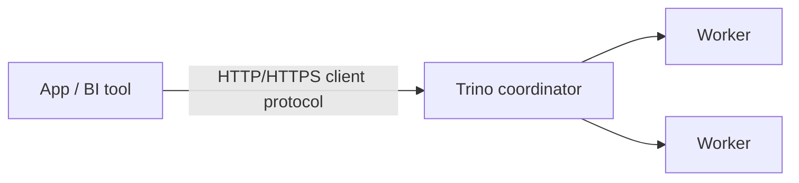
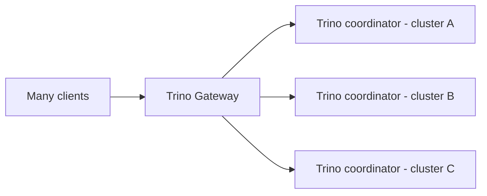

# Comprehensive guide to connecting to Trino

## Executive summary

Trino exposes a single, primary client interface: an HTTP/HTTPS “client protocol” (a REST-style API) used by the official CLI, the official JDBC driver, and community language clients. citeturn12view6turn16search5turn22search8 The practical consequence is that “all connection options” to Trino are variations of: (a) how you speak this HTTP protocol (directly, or via a driver/library), and (b) how you secure, route, and operate that traffic (TLS, authentication, gateways, pooling, retries, observability). citeturn12view0turn1view2turn2view1turn20view1

For most applications, the recommended integration strategy is:

* Prefer **official or Trino-community maintained clients** (JDBC, CLI, Python, Go, JavaScript/TypeScript, C#/.NET) where available, because they track protocol changes (headers, spooling, auth flows) and encode best practices like pagination, streaming, and cancellation. citeturn5view0turn2view0turn17view0turn3view0turn3view2turn7view0turn6view0  
* For BI/desktop tools and “ODBC-required” environments, select an ODBC driver that matches your throughput and platform needs. Trino’s ecosystem highlights vendor drivers (e.g., Simba by entity["company","insightsoftware","data connectivity vendor"], and an ODBC series by entity["company","Starburst Data","trino vendor"]), with important differences (direct protocol vs spooling protocol, Windows-only vs cross-platform). citeturn5view0turn13view0turn14view0turn15view0turn22search25  
* Treat **TLS as foundational**: Trino runs “with no security by default,” and Trino documentation emphasises that *all* authentication technologies require TLS/HTTPS in the baseline configuration (or a carefully configured proxy termination pattern). citeturn12view0turn1view2  
* For large result transfers or high-latency networks, enable and use **spooling protocol** (Trino 466+) where possible. It offloads result transfer to object storage, supports parallel downloads and compression, and is supported in newer versions of the JDBC driver, CLI, Python, and Go clients, and some vendor ODBC drivers. citeturn2view1turn2view0turn17view0turn3view0turn3view2turn13view0  

This report provides a rigorous inventory of connection options, a comparison matrix, code snippets for major languages, and an implementation checklist focused on flexible app integration.

## Connection surface area

### Core Trino architecture and the endpoint you actually connect to

A Trino cluster has a **coordinator** and one or more **workers**; clients submit statements to the coordinator, which plans and orchestrates execution across workers. citeturn12view6 The coordinator is therefore the universal “database endpoint” from the client perspective, and the client protocol is the communication layer between client and coordinator. citeturn12view6turn2view1

### Protocols available in practice

Trino’s connection options are best understood as layers:

* **Client protocol over HTTP/HTTPS (“direct protocol”)**: clients POST SQL text, then paginate results via `nextUri` until finished. citeturn2view1turn1view3  
* **Spooling protocol over HTTP/HTTPS + object storage**: the coordinator returns “segments” to fetch from object storage (S3-compatible, Azure Storage, or GCS), with JSON encodings optionally compressed; this improves throughput and can reduce coordinator load for large results. citeturn2view1turn1view4turn2view0turn17view0  
* **Drivers and libraries**: JDBC, ODBC, DBAPI, ADO.NET etc. These wrap the HTTP protocols while exposing familiar database APIs. citeturn2view0turn17view0turn3view0turn3view2turn6view0turn15view0  

There is no separate “wire protocol” like PostgreSQL’s native binary protocol; Trino’s canonical interface is HTTP, with results encoded as JSON (or JSON + compression in spooling). citeturn2view1turn1view4turn10view1

### Deployment patterns for connecting

Mermaid diagrams below illustrate common patterns.



Direct-to-coordinator is the simplest model; it aligns with Trino’s architecture where the coordinator is the “brain” and client entrypoint. citeturn12view6

```mermaid
flowchart LR
  A[App / BI tool] -->|HTTPS| LB[Reverse proxy / Load balancer]
  LB -->|HTTP or HTTPS to coordinator| C[Trino coordinator]
  C --> W[Workers]

  note right of LB
    TLS termination + WAF + rate limiting
    Requires "process forwarded" configuration
  end
```

Trino’s TLS guidance explicitly discusses terminating TLS at a load balancer and forwarding to Trino, and notes performance considerations for HTTPS (CPU cost, cipher choices). citeturn12view0



Trino Gateway is described as a load balancer/proxy/routing gateway for multiple Trino clusters, enabling a single connection URL and routing strategies such as blue/green or canary. citeturn20view1turn19view0

## Client and driver options

### Inventory of options

The table below lists connection options you can embed in an application or support via end-user tooling. “Official” here means published as part of Trino itself (CLI, JDBC). “Community” indicates Trino community maintained projects listed in the Trino ecosystem pages. citeturn5view0turn2view0turn17view0

| Option | Protocol(s) | Status | Primary ecosystems | Typical use |
|---|---|---|---|---|
| Trino JDBC driver | HTTP/HTTPS direct; spooling (466+) | Official | JVM languages; BI tools that use JDBC | Backend services, BI tools, ETL jobs in JVM citeturn2view0turn21search14 |
| Trino CLI | HTTP/HTTPS direct; spooling | Official | Shell + Java runtime | Scripting, operations, ad-hoc querying citeturn17view0 |
| Python client (DBAPI + SQLAlchemy) | HTTP/HTTPS direct; spooling supported | Community (Trino org repo) | Python | Notebooks, data science, ETL/ELT in Python citeturn3view0turn2view1 |
| Go `database/sql` driver | HTTP/HTTPS direct; spooling supported | Community (Trino org repo) | Go | Microservices, batch jobs, pipelines citeturn3view2turn2view1 |
| JS/TS client | HTTP/HTTPS direct | Community (Trino org repo) | Node.js / TypeScript | Web backends, serverless, tooling citeturn22search26turn22search16 |
| C#/.NET client (ADO.NET interfaces) | HTTP/HTTPS direct | Community (Trino org repo) | .NET | Enterprise apps, integration where ADO.NET required citeturn21search3turn22search1 |
| Vendor ODBC drivers (direct or spooling) | ODBC API wrapping Trino HTTP protocols | Third-party | BI/Desktop tools, Microsoft SQL linked servers, etc. | BI tools, legacy ODBC environments citeturn13view0turn15view0turn22search25 |
| Ruby client | HTTP/HTTPS direct | Third-party | Ruby | Scripts, services citeturn8view5 |
| Rust client (Prusto) | HTTP/HTTPS direct | Third-party | Rust | CLI/tools/services in Rust citeturn7view8 |
| R client (RPresto) | HTTP/HTTPS direct | Third-party | R | Analytics workflows citeturn10view1 |
| PHP (legacy Presto HTTP client) | HTTP direct (Presto protocol) | Third-party / legacy | PHP | Only advisable with strong compatibility validation citeturn23view0turn16search1 |
| Build your own HTTP client | Direct or spooling | Custom | Any language | Special requirements; control over retries/pooling citeturn1view3turn2view1 |

### Option details by capability

#### JDBC driver (official)

**Protocols and result transfer.** The JDBC driver uses the Trino client protocol over HTTP/HTTPS to talk to the coordinator. citeturn21search14 It can automatically use the spooling protocol (Trino 466+) when configured on the cluster, and requires network access from the client JVM to the configured spooling object storage. citeturn2view0turn2view1

**Authentication and TLS.** JDBC supports multiple auth flows including browser-based external authentication for OAuth2, password-based authentication, and certificate-based options via Java keystores. citeturn2view0turn12view0turn1view2 Trino’s security docs stress that TLS is foundational for any authentication scheme. citeturn12view0turn1view2

**Prepared statements and parameter binding.** Trino supports prepared statements with `?` parameters at the SQL level. citeturn16search23 The JDBC driver has an `explicitPrepare` configuration that can run prepared statements as a single `EXECUTE IMMEDIATE` query (rather than PREPARE + EXECUTE), reducing network overhead and HTTP header size, requiring Trino 431+. citeturn16search7turn16search11turn16search19

**Common pitfalls.** Metadata retrieval uses the `system.jdbc` schema; lack of access to this schema can break tools that expect metadata. citeturn2view0 Prepared statements can also stress HTTP header limits in some patterns (e.g., huge SQL text in PREPARE headers), which is part of why `EXECUTE IMMEDIATE` support matters. citeturn16search25turn16search7

**Example JDBC URL.** The JDBC driver uses a `jdbc:trino://host:port` style URL with optional `catalog` and `schema`; the Trino CLI documentation notes it can use a JDBC URL after removing the `jdbc:` prefix. citeturn2view0turn17view0

#### CLI (official)

The CLI is a self-executing JAR, uses the client protocol over HTTP/HTTPS, and should be the same version as the cluster or newer (versions before 350 are not supported). citeturn17view0turn16search1 It supports multiple authentication modes directly on the command line: username/password (`--password` with `TRINO_PASSWORD`), OAuth2 external authentication (`--external-authentication`), certificate auth via keystore, JWT via `--access-token`, Kerberos options, and TLS controls (e.g., `--insecure` “only for debugging”). citeturn17view0turn12view0

For spooling, the CLI automatically uses spooling when configured and can choose encodings (`json+zstd` recommended). citeturn17view0turn2view1 It also exposes client-side operational controls: request timeout (`--client-request-timeout`), network logging levels, compression toggles, proxy flags, and session properties. citeturn17view0

#### Python client (community)

The Trino Python client provides a low-level client, a DBAPI 2.0 implementation, and a SQLAlchemy adapter; it supports Python ≥ 3.9 and PyPy. citeturn22search6turn3view0 It supports multiple auth methods (basic/password, JWT, OAuth2, certificate auth) and TLS verification configuration. citeturn3view0turn12view0 It can use the spooling protocol; when spooling is enabled, the client must have access to object storage, and encoding/compression choices influence throughput and CPU usage. citeturn2view1turn3view0turn1view4

The library also documents transaction control via an `isolation_level` field (noting that most Trino connectors do not support transactions). citeturn3view0turn11search3

#### Go client (community)

The Go client is a `database/sql` driver that sends SQL statements to Trino and returns results. citeturn22search32turn3view2 It supports basic auth, Kerberos, JWT, and custom HTTP clients, and includes spooling protocol support starting at a documented version threshold. citeturn4view4turn2view1 The Go client’s support for injecting a custom `http.Client` is a key engineering hook for your app, because it lets you standardise timeouts, connection reuse, TLS settings, and proxy behaviour across your service. citeturn4view4

#### JavaScript / TypeScript client (community)

The TypeScript client (`trino-client`) runs on Node.js, with documented requirements and an example using `BasicAuth`. citeturn22search26turn22search16 Its API returns an iterator of `QueryResult`, which is naturally suited to streaming and incremental processing in Node services. citeturn22search26

#### C# / .NET client (community)

The Trino C# client is a streaming client library with ADO.NET interfaces. Its stated design priorities include response performance (fast row return), full ADO.NET implementation, streaming with read-ahead into a configurable buffer, session support, and parameterised query support; it also emphasises flexible/customisable authentication (useful for token refresh flows). citeturn21search3turn21search16turn22search1

This makes it a strong fit when you want Trino access to feel like “normal database access” for .NET applications and integration frameworks relying on `DbConnection/DbCommand/IDataReader`. citeturn22search1turn21search16

#### ODBC drivers (third-party; critical for BI tools)

ODBC is the key compatibility layer for many desktop BI tools and legacy environments.

* **Starburst ODBC driver**: available as a V2 series (Windows/macOS/Linux) and a V3 series (Windows-only). The V3 series is redesigned to leverage the Trino spooling protocol and is described as more performant than V2 (which uses the direct protocol). citeturn13view0turn14view0turn15view0  
  *V3 connection strings*: documented DSN-less form includes server/port/auth type/credentials and optional TLS verification, proxy settings, session properties, roles, and logging controls. citeturn15view0turn15view1turn15view2  
  *Auth types*: includes `Password`, `JWT`, `OAuth2`, and Windows integrated/password mechanisms; TLS is required unless no authentication is used. citeturn15view1turn15view2  

* **Simba Trino ODBC Connector**: vendor documentation frames it as supporting authenticated connections with SSL/TLS; it explicitly references support for TLS versions up to 1.2 (and negotiates the highest mutually supported version). citeturn22search25turn21search2  
  The Trino ecosystem site lists a “Simba Trino ODBC driver” and “Simba Trino JDBC driver” as available ecosystem options (vendor-provided). citeturn5view0turn21search23  

When designing a flexible integration, it is useful to treat ODBC support as an *adapter surface* for end-user tools—your app can standardise on JDBC/HTTP internally while allowing ODBC externally where required.

#### Ruby client (third-party)

The Ruby client demonstrates streaming and convenience methods: creating a query, iterating row-by-row (`each_row`), enabling per-request HTTP debugging, and terminating queries (`kill`). citeturn8view5 It also documents client-side timeouts (`query_timeout`, `plan_timeout`), proxy support (including `no_proxy`), and gzip. citeturn8view5

#### Rust client (third-party)

The Prusto client offers a builder-based configuration and supports both HTTP and a declared HTTPS mode. citeturn7view8 As with many HTTP JSON-based integrations, careful attention to streaming, buffering, and error handling is critical to avoid large in-memory result sets in Rust services (this is an architectural consideration implied by Trino’s paginated REST results). citeturn2view1

#### R client (third-party)

RPresto documents how to connect to Trino by enabling Trino-style headers (a key migration difference). It also explains that the REST API returns JSON and warns about `BIGINT` precision limitations stemming from JSON/JavaScript numeric representation (2^53). citeturn10view1turn16search1

#### PHP (legacy Presto HTTP client)

A commonly cited PHP client (`php-presto-client`) is explicitly a “prestodb http protocol client for php” and provides a statement client that executes, advances through pages, yields results, and can cancel requests. citeturn23view0 However, it is a legacy Presto protocol integration (last release noted in 2017) and does not advertise Trino header support. citeturn23view0turn16search1

If you must support PHP, the robust approach is usually either:
* Implement Trino’s current client protocol directly (HTTP/HTTPS with `X-Trino-*` headers) using your standard HTTP stack, guided by the Trino REST API reference; or  
* Use a gateway/proxy that can bridge compatibility—Trino documents a transition mechanism (`protocol.v1.alternate-header-name=Presto`) to support older header prefixes during migration. citeturn1view3turn16search1turn16search37

## Security and authentication

### TLS/HTTPS as the baseline

Trino runs unsecured by default and allows HTTP connections, but the Trino TLS documentation states that configuring TLS to require HTTPS is the step that underpins all Trino authentication technologies. citeturn16search30turn12view0turn1view2 The CLI similarly emphasises HTTPS as typical and notes the recommended approach is globally trusted certificates, with “skip certificate validation” intended for debugging only. citeturn17view0turn12view0

A key operational insight from Trino’s TLS documentation is that HTTPS can increase CPU usage (cipher suite costs), and Trino explicitly discusses terminating TLS in an external load balancer as a preferred pattern. citeturn12view0

### Authentication mechanisms and client support map

Trino’s “authentication types” documentation consolidates the supported schemes and notes operational prerequisites (TLS / process forwarding, shared secret). citeturn1view2turn12view0turn12view2 The CLI documentation demonstrates how clients use these auth systems in practice (password, OAuth2 SSO, cert auth, JWT, Kerberos). citeturn17view0

**Password- and LDAP-backed auth.** Separate Trino security pages describe “password file authentication” and “LDAP authentication” as frontend username/password validation, explicitly stating they operate over HTTPS and apply to clients such as CLI, JDBC, and ODBC drivers. citeturn16search14turn16search10turn12view0

**JWT and OAuth2/OIDC.** OAuth2 external authentication is documented both in the JDBC driver properties and CLI behaviour (browser-based SSO flow). citeturn2view0turn17view0turn1view2 ODBC V3 connection keywords also include `JWT` and `OAuth2` authentication types. citeturn15view1turn15view2

**Certificate authentication.** Trino supports certificate authentication, and the CLI shows the keystore parameters used to present client certificates. citeturn17view0turn12view1

**Kerberos.** Trino supports Kerberos (e.g., CLI flags for principal, keytab, krb5 config), and the Go client highlights Kerberos support. citeturn17view0turn4view4 ODBC V3 also supports Windows integrated/password mechanisms using Kerberos/NTLM in Windows environments. citeturn15view2turn15view1

### Secure internal communication and shared secret

Trino’s internal communication documentation requires configuring a shared secret in scenarios including “when using any authentication between clients and the coordinator” (and for internal TLS between nodes). citeturn16search26turn12view2 This matters for your app integration because a “client-side auth rollout” often requires a synchronized server-side internal security rollout (coordinator and workers), otherwise authentication can be misconfigured in subtle ways. citeturn12view2turn12view6

## Operational and performance considerations

### Session model, pooling, and connection management

Although JDBC/ODBC present a “connection” abstraction, Trino’s underlying client protocol is HTTP-based and paginated; the coordinator and clients communicate via REST API calls. citeturn12view6turn2view1turn21search14 In practice, pooling still matters primarily for:
* reusing client-side HTTP connections (keep-alive) and TLS sessions;
* reusing session configuration (catalog/schema, roles, session properties, tags);
* controlling concurrency and backpressure at the application layer.

JDBC supports many session-level parameters (catalog/schema, session properties, roles, extra credentials, tags, trace token) that you can bind per pooled connection to model user/session identity. citeturn2view0turn21search14 The CLI similarly supports catalog/schema selection, session properties, client tags, extra credentials, and timeouts. citeturn17view0

Language clients expose similar levers: the Go driver supports custom HTTP clients, and the C# client exposes session support and streaming buffers. citeturn4view4turn21search3turn21search16

### Throughput and latency: direct vs spooling

The spooling protocol is explicitly designed to improve throughput and robustness for clients that transfer large result sets. It stores results in object storage and can allow query completion even if the client isn’t continuously pulling pages, while also enabling parallel downloads and compression. citeturn2view1turn1view4

Spooling introduces a new dependency: your client network path must reach the configured object storage (S3-compatible, Azure Storage, or GCS), and your security posture must include secure access to that storage. citeturn2view1turn17view0turn2view0

Where spooling is unavailable (or operationally undesirable), the direct protocol is still effective but more sensitive to high-latency paths and client backpressure, because result pagination is mediated by coordinator `nextUri` requests. citeturn2view1turn1view3

### Query cancellation, timeouts, and retries

**Cancellation.** Trino’s REST API reference documents request/response structure and includes termination behaviour by sending a `DELETE` to the `nextUri` (and describes retry strategies for transient HTTP failures like 502/503/504 and 429 with `Retry-After`). citeturn1view3 From a client-integration standpoint, it is essential to implement cancellation as a first-class feature: it is how you prevent abandoned interactive queries from consuming cluster resources.

Several client libraries surface cancellation:
* Ruby client has a `kill` method. citeturn8view5  
* The legacy PHP Presto client demonstrates a cancellation call (`cancelLeafStage`). citeturn23view0  

**Client-side timeouts.** The CLI exposes a client request timeout (`--client-request-timeout`, default 2 minutes) that terminates client requests after a duration. citeturn17view0 Ruby documents query and plan timeouts as well. citeturn8view5

**Server-side limits.** Trino supports resource groups and session properties; client tags and session properties can influence routing and resource policies. citeturn17view0turn2view0turn20view1

### Transactions and ACID semantics

Trino provides SQL statements for transaction control (e.g., `START TRANSACTION`). citeturn11search7 However, Trino explicitly notes that most Trino connectors do not support transactions. citeturn11search3 Therefore, “ACID semantics” are not a property of Trino as a whole; they are connector- and storage-dependent, and many Trino usage patterns should assume each statement is independently executed without multi-statement transaction guarantees. citeturn11search3turn12view6

Where a client library offers transaction APIs (e.g., Python describing isolation levels), you should treat them as conditional features and explicitly test on your target connectors. citeturn3view0turn11search3

### Observability: metrics, logging, and query event streams

Trino supports OpenMetrics at `/metrics` on the coordinator, protected by the configured authentication, and gives an example `curl` using `X-Trino-User` to retrieve metrics. citeturn12view3 Trino also exposes extensive JMX metrics and documents enabling JMX via configuration properties. citeturn12view4

For query-level observability, the HTTP event listener plugin streams query events (JSON) to an external HTTP service, enabling downstream processing for usage analytics, chargeback, auditing, and performance analysis. citeturn12view5

On the client side, both CLI and ODBC drivers provide explicit network/driver logging controls:
* CLI has `--network-logging` levels (NONE/BASIC/HEADERS/BODY). citeturn17view0  
* Starburst ODBC V3 documents log level options and log file retention/size behaviour. citeturn15view1  

## Implementation guidance

### Comparison table: pros/cons and “best fit” by use case

The table below is deliberately opinionated for app integration design.

| Use case | Recommended option(s) | Why | Cautions |
|---|---|---|---|
| Backend services on JVM | JDBC (official) | Mature, broad tooling compatibility; session properties/roles/tags; spooling support; prepared statement optimisations (`EXECUTE IMMEDIATE`). citeturn2view0turn16search7turn2view1 | Treat pooling as client-side; validate metadata access to `system.jdbc`. citeturn2view0turn12view6 |
| Python ETL / notebooks | Python client | DBAPI + SQLAlchemy adapter; spooling support; integrates with Python ecosystems. citeturn3view0turn22search6turn2view1 | Transactions often unsupported by connectors. citeturn11search3turn3view0 |
| Go microservices | Go driver | Standard `database/sql`; auth options incl. Kerberos/JWT; custom `http.Client`; spooling support. citeturn3view2turn4view4turn2view1 | Ensure robust retry + cancellation strategy at app layer. citeturn1view3turn2view1 |
| Node.js services / tooling | JS/TS client | Iterator-based streaming; easy embedding in Node apps. citeturn22search26turn22search16 | Validate auth needs; implement backpressure and cancellation. citeturn1view3turn2view1 |
| .NET enterprise integration | C# ADO.NET client | Explicit focus on streaming performance, buffers, session and parameter support; designed for ADO.NET patterns. citeturn21search3turn21search16turn22search1 | Track project maturity and edge cases; test with your ORM/framework behaviours. citeturn22search21turn22search18 |
| BI tools requiring ODBC | Vendor ODBC (direct or spooling) | Broad tool compatibility; Starburst V3 can leverage spooling; extensive connection keywords and logging. citeturn13view0turn15view0turn15view1 | Platform restrictions (e.g., Starburst V3 Windows-only); auth keyword compatibility; password encoding quirks. citeturn14view0turn15view2 |
| Multi-cluster routing / HA | Trino Gateway | Single URL for users, workload distribution, blue/green, canary routing. citeturn20view1turn19view0turn19view1 | Introduces additional infrastructure and operational surface (state/config, routing policies). citeturn20view1 |
| “Any language” embedding | Custom HTTP client | Total control over retry/pooling/cancellation and auth integration. citeturn1view3turn2view1 | Easiest to get subtly wrong (headers, pagination, spooling, retries); prefer existing clients when possible. citeturn1view3turn16search5 |

### Migration considerations (PrestoSQL → Trino; and “older clients”)

Trino’s migration guidance for the PrestoSQL→Trino rename highlights a client protocol breaking change: HTTP headers changed from `X-Presto-*` to `X-Trino-*` (starting with Trino 351), making newer CLI/JDBC drivers only compatible with Trino 351+ unless you configure compatibility. citeturn16search1turn16search37turn16search30

For a transition period, Trino documented a server configuration property `protocol.v1.alternate-header-name=Presto` to allow older clients expecting `X-Presto-*` headers. citeturn16search1turn16search37turn16search21 This is particularly relevant if you must support legacy language clients (for example, older R/PHP clients or embedded systems). citeturn10view1turn23view0

At the JDBC URL level, legacy Presto JDBC uses the `jdbc:presto://host:port[/catalog[/schema]]` format. citeturn16search28 Trino’s JDBC driver uses `jdbc:trino://...` and the CLI notes it can accept JDBC URL parameters (after removing the `jdbc:` prefix). citeturn2view0turn17view0

### Implementation checklist for flexible app integration

Use this as a build checklist. Each item is included because it maps to documented Trino behaviour or a common integration failure mode.

**Client selection and versioning**
- Confirm your chosen client supports your Trino version; for official CLI, versions before 350 are unsupported, and CLI should be identical to cluster version or newer. citeturn17view0turn16search1  
- If you rely on spooling throughput improvements, ensure both server and client versions support spooling. citeturn2view1turn2view0turn17view0  

**Security baseline**
- Enforce HTTPS (TLS) and validate certificates; reserve “insecure/no verification” for debugging only. citeturn12view0turn17view0  
- When enabling client authentication, configure `internal-communication.shared-secret` consistently across nodes. citeturn12view2  
- Choose an auth scheme aligned to your identity model (password/LDAP, OAuth2 SSO, JWT, Kerberos, certificate auth) and verify the client supports it. citeturn1view2turn17view0turn15view1  

**Connection/session modelling**
- Decide whether your app will map “user identity” to Trino sessions (headers/user, session properties, roles). citeturn2view0turn17view0  
- Standardise per-request tags and source identifiers for observability and policy routing. citeturn2view0turn17view0turn20view1  

**Timeouts, cancellation, retries**
- Implement query cancellation using the REST API termination mechanism and expose it in your app UI/API. citeturn1view3turn8view5  
- Enforce client-side timeouts (connect, request, query/plan) and align them with cluster resource policies. citeturn17view0turn8view5  
- Add controlled retries only for documented transient HTTP errors (e.g., 429/502/503/504) and treat writes/DDL carefully to avoid unsafe retries. citeturn1view3  

**Result handling**
- Stream results incrementally (iterator/reader patterns) and avoid buffering full result sets in memory. (This follows directly from Trino’s paginated HTTP result model and the streaming focus of several clients.) citeturn2view1turn21search3turn22search26turn8view5  
- For large transfers, prefer spooling encodings with compression (`json+zstd` recommended by CLI) and ensure object storage access is available in your runtime environment. citeturn17view0turn2view1turn1view4  

**Prepared statements and parameter binding**
- Prefer parameterised queries where supported; understand Trino’s `?` parameter model and `EXECUTE IMMEDIATE ... USING` semantics. citeturn16search23turn16search19  
- If using JDBC with large prepared statements, consider the `explicitPrepare` behaviour and Trino version requirements to reduce overhead and header size. citeturn16search7turn16search11  

**Monitoring and logging**
- Enable `/metrics` scraping and integrate with your monitoring stack; remember it follows the same authentication model as the Web UI and client protocol. citeturn12view3  
- Enable JMX and/or use Trino event listeners for query audit streams where required. citeturn12view4turn12view5  
- Turn on client-side network/driver logs selectively for troubleshooting (CLI network logging; ODBC driver log settings). citeturn17view0turn15view1  

## Code snippets and example configurations

The snippets below are intentionally minimal “connect + simple query” examples. Replace hostnames, ports, and auth with your deployments.

### Java with JDBC (official driver)

```java
import java.sql.*;

public class TrinoJdbcExample {
  public static void main(String[] args) throws Exception {
    String url = "jdbc:trino://trino.example.com:8443/hive/default?SSL=true&SSLVerification=FULL";
    try (Connection conn = DriverManager.getConnection(url, "alice", "secret");
         Statement stmt = conn.createStatement();
         ResultSet rs = stmt.executeQuery("SHOW CATALOGS")) {

      while (rs.next()) {
        System.out.println(rs.getString(1));
      }
    }
  }
}
```

JDBC communicates with Trino over the HTTP/HTTPS client protocol and supports URL parameters (as also referenced by the CLI). citeturn21search14turn17view0

### Python (DBAPI)

```python
import trino
from trino.auth import BasicAuthentication

conn = trino.dbapi.connect(
    host="trino.example.com",
    port=8443,
    http_scheme="https",
    user="alice",
    auth=BasicAuthentication("alice", "secret"),
    catalog="hive",
    schema="default",
)

cur = conn.cursor()
cur.execute("SHOW CATALOGS")
for row in cur.fetchall():
    print(row)
```

The Python client provides DBAPI 2.0 and a SQLAlchemy adapter and supports TLS/auth configuration. citeturn3view0turn22search6turn12view0

### Go (`database/sql`)

```go
package main

import (
  "database/sql"
  "fmt"
  _ "github.com/trinodb/trino-go-client/trino"
)

func main() {
  // DSN format is documented by the Go client.
  dsn := "http://alice@trino.example.com:8080?catalog=tpch&schema=tiny"

  db, err := sql.Open("trino", dsn)
  if err != nil { panic(err) }
  defer db.Close()

  rows, err := db.Query("SELECT count(*) FROM tpch.tiny.nation")
  if err != nil { panic(err) }
  defer rows.Close()

  for rows.Next() {
    var c int64
    if err := rows.Scan(&c); err != nil { panic(err) }
    fmt.Println(c)
  }
}
```

The Go driver is a Trino client that integrates with `database/sql` and supports HTTP/HTTPS and multiple auth strategies. citeturn3view2turn4view4

### Node.js / TypeScript (community client)

```ts
import { Trino, BasicAuth } from "trino-client";

async function main() {
  const trino = Trino.create({
    server: "http://trino.example.com:8080",
    catalog: "tpch",
    schema: "tiny",
    auth: new BasicAuth("alice"),
  });

  const iter = await trino.query("SHOW CATALOGS");
  for await (const res of iter) {
    if (res.data) {
      for (const row of res.data) console.log(row);
    }
  }
}

main().catch(console.error);
```

The JS/TS client documents this creation pattern and iterator usage. citeturn22search26turn22search16

### C# / .NET (Trino community ADO.NET client)

```csharp
using System;
using System.Data.Common;
using Trino.Data.ADO;

class Program
{
  static void Main()
  {
    var connString =
      "Host=trino.example.com;Port=8443;Ssl=true;User=alice;Catalog=hive;Schema=default;";

    using DbConnection conn = new TrinoConnection(connString);
    conn.Open();

    using DbCommand cmd = conn.CreateCommand();
    cmd.CommandText = "SHOW CATALOGS";

    using var reader = cmd.ExecuteReader();
    while (reader.Read())
    {
      Console.WriteLine(reader.GetString(0));
    }
  }
}
```

The C# client positions itself as a streaming library with ADO.NET interfaces, session support, and parameter support. citeturn21search3turn22search1turn21search16

### Ruby (third-party)

```ruby
require 'trino/client'

client = Trino::Client.new(
  server: "https://trino.example.com:8443",
  user: "alice",
  # Example: SSL options, proxy, and timeouts are supported by the client.
)

q = client.query("SHOW CATALOGS")
q.each_row do |row|
  p row
end
```

The Ruby client documents `each_row`, timeouts, proxy, gzip, and query termination (`kill`). citeturn8view5

### Rust (Prusto)

```rust
use prusto::{Client, ServerType};

#[tokio::main]
async fn main() -> Result<(), Box<dyn std::error::Error>> {
    let client = Client::builder("trino.example.com", 8443)
        .server_type(ServerType::Https)
        .user("alice")
        .build()?;

    let rows = client.get_all("SHOW CATALOGS").await?;
    for r in rows {
        println!("{:?}", r);
    }
    Ok(())
}
```

Prusto documents a builder model and HTTPS server type selection. citeturn7view8

### ODBC (Starburst ODBC V3 examples)

DSN-less connection string (generic form):

```text
DRIVER={Starburst ODBC Driver};
Server=sep.example.com;
Port=8443;
AuthenticationType=Password;
SSL=1;
UID=user1;
PWD={ my Pa;}}&d};
```

JWT example form:

```text
Driver=Starburst ODBC Driver;
Server=yourcluster.trino.galaxy.starburst.io;
Port=443;
AuthenticationType=JWT;
SSL=1;
AccessToken=eyJraWQiOiJCVThtQW1h...
```

These formats and keywords (TLS verification, proxy, session props, roles, logging) are documented in the Starburst ODBC V3 pages. citeturn15view0turn15view1turn15view2

### PHP (legacy Presto HTTP client; use with caution)

```php
<?php
$client = new \Ytake\PrestoClient\StatementClient(
    new \Ytake\PrestoClient\ClientSession('http://trino.example.com:8080/', 'alice'),
    'SHOW CATALOGS'
);

// execute HTTP request
$client->execute();

// advance and read
$client->advance();
$result = $client->current();

// cancel example
$client->cancelLeafStage();
```

This library is a PrestoDB HTTP protocol client with paging and cancellation helpers; using it against Trino generally requires careful protocol/header compatibility validation or server compatibility configuration. citeturn23view0turn16search1turn16search37