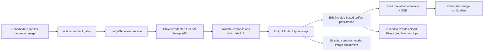

# Image Generation Tool — Architecture and UX Proposal

Date: 2026-07-12

Status: Proposed

Review: Repository inspection + Claude Fable 5 architecture/UX review

## 1. Executive decision

Ship image generation first as a **provider-neutral, locally executed
`generate_image` tool**. Configure its target at app level by selecting an
existing OpenAI-family provider credential and an explicit image model. For the
first backend, call OpenAI's Image API with `gpt-image-2`. Any supported chat
model—OpenAI, Anthropic, Gemini, Bedrock, or compatible—can then call the same
tool during an agent loop.

Treat each output as **one canonical `type:"image"` artifact**, not as paired
`image` and `file` records. Keep image bytes out of the model-facing tool result.
Reuse the current artifact persistence threshold, which externalizes large
artifact content to disk, and extend the raw endpoint and Files view to treat a
generated image as a downloadable file. Raw-binary artifact storage can remove
the data-URI overhead later; it is not an MVP prerequisite.

Add OpenAI Responses-native `image_generation` only in a later phase, behind the
same normalized generated-image contract. It is valuable for provider-managed
multi-turn editing, but it is a poor MVP foundation because it only works for
supported Responses targets and requires substantial new hosted-tool stream
parsing.

This gives the product one user-facing capability and two possible execution
strategies:

| Strategy | Role | Recommendation |
| --- | --- | --- |
| Local `generate_image` → Image API | Default, cross-provider generation and explicit image-model selection | MVP |
| Responses hosted `image_generation` | Optional optimized path for supported OpenAI Responses conversations | Phase 3 |

The current OpenAI documentation supports this split: the Image API is the
direct single-request generation/edit surface, while the Responses API exposes
image generation as a built-in conversational tool. See
[OpenAI image generation](https://developers.openai.com/api/docs/guides/image-generation).

## 2. Product principles

1. **The chat model and image model are separate choices.** A Claude chat can
   generate through GPT Image without changing the conversation provider.
2. **One asset, one artifact ID.** The same `type:"image"` record opens the
   preview, downloads decoded bytes, appears in Files, and is referenced later.
3. **Bytes stay out of model context.** The data URI belongs only in the
   artifact payload; the compact result contains IDs and metadata.
4. **Configuration and permission are separate gates.** Image generation must
   be enabled and the run/tool permission policy must allow the billable
   external call.
5. **The model chooses intent; app settings own defaults.** Tool arguments
   express content and useful overrides. Model name, endpoint, credentials,
   safety baseline, limits, and default quality live in image-generation
   settings.
6. **Progress precedes partial previews.** The synchronous MVP emits useful
   stages. Streaming partial images is a later enhancement.
7. **Edits create descendants.** Never overwrite the source artifact. Record
   parent IDs and the edit prompt so provenance remains inspectable.

## 3. Proposed user experience

### 3.1 Configuration

Add one **Image generation** settings block alongside provider/model settings;
do not add a new Connections catalog type. Connections in this product model
data sources, while image generation is a model capability. The block should
contain:

- Enable/disable toggle.
- Image target/provider ID: select an existing compatible OpenAI-family provider
  configuration and reuse its secret reference.
- Provider and endpoint identity (MVP: OpenAI Image API).
- Image model (MVP default: `gpt-image-2`, stored explicitly rather than hidden
  in code).
- Defaults: quality, size/aspect preset, output format, compression.
- Limits: maximum output pixels and maximum images per run. MVP count is one per
  call because the current artifact output contract is singular.
- A real **Generate test image** check using a cheap/low-quality prompt. A
  catalog-only “test” would not verify model access, organization verification,
  quota, moderation, or binary response handling.

Do not use environment variables for this. Persist non-secret settings through
the existing settings service and credentials through the existing encrypted
secrets store. Store a credential/config reference, not a copied API key.

The capability should be explicit-consent/billable and default Off for new
users. A valid target exposes `generate_image`; a missing, disabled, unverified,
or unsupported target does not. Tool approval remains a separate per-call or
persistent grant through the existing execute/write permission machinery.

### 3.2 During generation

Add a purpose-built **Generated image card** to the live transcript path in
`CollapsedToolsSummary` and its `IntermediateThinkingBlock` mirror. Do not build
the feature around the currently unused image branch in `ToolResultBlock`:

1. **Queued:** fixed-aspect skeleton, “Preparing image”.
2. **Generating:** shimmer, elapsed time, model/quality summary, stage text from
   `tool_progress` (`requesting`, `generating`, `saving`), and Cancel. Preserve
   the requested aspect ratio to avoid layout shift.
3. **Completed:** large inline image (object-contain, about 280 px maximum
   height—not a 40×40 thumbnail), filename, dimensions, format, quality, model,
   and a restrained provenance line.
4. **Failed/blocked:** retain the prompt summary and settings, show a useful
   remediation action, and do not create a broken artifact.

Primary card actions:

- **Open** in the artifact inspector.
- **Use in chat** (pin/reference the canonical artifact).
- **Edit** (seed the composer with an edit request and attach the source image).
- **Regenerate** (prefill the same prompt/settings as a draft for a new,
  independent generation).
- Overflow: Download, Copy prompt, View details/provenance.

Edit and Regenerate must never auto-run; keep the user in control of the final
prompt. For a later 2–4 variant phase, render one gallery card with a stable
grid. Each tile is its own canonical image artifact. The gallery has no extra
artifact record; it renders the tool result's ordered artifact IDs. Keyboard
focus, prompt-derived alt text, reduced-motion behavior, and screen-reader
status announcements are required.

### 3.3 Inspector

The artifact panel should show the image against a neutral/checkerboard-aware
canvas with fit, 100%, and zoom controls. Its details drawer should show:

- Original prompt and any revised prompt returned by the provider.
- Model, image target, endpoint strategy, size, quality, format,
  compression, and creation time.
- Source/parent artifact IDs for edits.
- Run ID, tool call ID, request ID, latency, and usage when available.
- Safety outcome without exposing internal classifier details.

For generated images, Raw mode should show metadata JSON or be suppressed; it
must not dump a multi-megabyte base64 URI into the inspector.

Download must use `/api/artifacts/{id}/raw` so the user receives the original
bytes, not a browser re-encoding or the textual data URI.

## 4. Runtime architecture



Introduce an `ImageGenerator` service interface outside the provider chat
adapters. The local tool depends on this interface rather than reading settings,
secrets, or HTTP endpoints itself. The OpenAI implementation resolves the
configured credential reference, builds an Image API request, and returns raw
assets plus provider metadata.

Suggested internal contract:

```text
Generate(ctx, Request) -> Result

Request:
  prompt
  size/aspect, quality, format, compression

Result:
  asset { bytes, mime, width, height, provider image ID? }
  revised prompt, request ID, usage, latency
```

The service must honor `ctx` cancellation. Use bounded HTTP response bodies and
validate decoded size and MIME signatures. The tool converts the validated
result into `Output.Artifact{Type:"image", Content:dataURI}`; the existing
manager persists it and externalizes large content above its 512 KiB threshold.
Do not place the data URI in `Output.Result` or `ResultMetadata`, where the 64 KiB
tool-envelope compactor would destroy it and model context would balloon.

## 5. Tool contract

### 5.1 MVP schema

Expose one stable tool name:

```json
{
  "name": "generate_image",
  "arguments": {
    "prompt": "required string",
    "aspect_ratio": "auto | square | portrait | landscape | wide",
    "size": "auto or supported WIDTHxHEIGHT",
    "quality": "auto | low | medium | high",
    "format": "png | jpeg | webp"
  }
}
```

Rules:

- Require `prompt` and cap its size.
- MVP always produces one image. Add edit inputs and `count` only when the
  ordered multi-artifact contract is implemented; do not fake variants with
  duplicate internal calls.
- Validate requested options against the selected image model. Do not advertise
  unsupported values merely because another GPT Image model supports them.
- Prefer semantic aspect presets in normal model calls; keep exact pixel size as
  an advanced override.
- App defaults fill omitted values; the tool never chooses credentials,
  endpoint, or model.

The current `gpt-image-2` contract, including flexible size constraints and lack
of transparent-background support, must come from a curated capability entry or
probe evidence—not scattered UI conditionals.

### 5.2 Result envelope

Keep model-facing output small:

```json
{
  "ok": true,
  "artifact_id": "primary-artifact-id",
  "result": {
    "status": "completed",
    "mime_type": "image/png",
    "width": 1536,
    "height": 1024,
    "size_bytes": 2198421,
    "revised_prompt": "..."
  },
  "result_metadata": {
    "provider": "openai",
    "model": "gpt-image-2",
    "request_id": "...",
    "latency_ms": 42000
  }
}
```

Set `ResultMetadata` explicitly, as required by the repository's static output
contract. No base64, data URI, local absolute path, or secret appears in this
envelope. Add `artifact_ids` later with gallery support; `artifact_id` remains
the primary/first asset for compatibility.

### 5.3 Errors and retries

Normalize errors into categories already understood by the tool UI where
possible:

- `auth` / `target_invalid`: deep-link to Image generation settings.
- `rate_limited` / `quota_exceeded`: show retry timing or account guidance.
- `moderation_blocked`: a distinct non-retryable result metadata code; offer
  “Revise prompt”, not Retry. Keep the explanation generic and store only safe
  coarse diagnostics.
- `invalid_input`: identify the option/source that must change.
- `provider_unavailable`: perform at most one bounded internal retry for 429/5xx
  with context-aware backoff, then allow a manual retry.
- `cancelled`: quiet terminal state, no error toast, no durable artifact.

Blind retries can create duplicate billable images. When the provider exposes
an idempotency mechanism, use a stable key derived from run ID and tool call ID.

## 6. Canonical artifact and file design

The right MVP representation is the repository's existing image artifact, with
two view-level extensions. Use one stored artifact per generated asset:

```text
type: image
content: data:image/png;base64,...
content_path: populated automatically when existing size threshold is exceeded
metadata:
  mimeType: image/png
  source: generated_image
  generated: true
  width, height, sha256, sizeBytes
  provider, model, requestId
  prompt, revisedPrompt
  sourceArtifactIds, parentArtifactId
  tool_name, tool_call_id, run_id
```

This avoids the connector-download pattern of a result artifact plus a sibling
file artifact. That pattern is appropriate when a data result points to a
download; here, the image itself is the result. Pairing records would store the
same logical object twice and show inconsistent rows across surfaces.

Required extensions:

- `/api/artifacts/{id}/raw` must decode and serve any authorized generated
  `type:"image"` artifact with the correct MIME, filename, and extension. Today
  the raw path admits only the special `image_attachment` tool name.
- The Files surface and its file-audit membership predicate must include
  `source:"generated_image"` image artifacts and show a **Generated** provenance
  chip. Files is a view over assets, not a reason to change the artifact type.

Current size-based persistence is adequate for MVP: typical generated images
exceed the 512 KiB threshold and are externalized to disk automatically, albeit
as a data-URI text file. Raw-binary persistence would remove base64 overhead and
the `.txt` indirection, but it touches both stores and artifact hydration paths
without changing the user experience. Defer it to Phase 3.

Same-run continuation also largely exists: an image artifact with a data URI is
converted into a native `ImageAttachment`. Later turns reference/pin the
artifact and rehydrate it. Preserve and document the current limits—four images,
14 MB per URI, and 15 MB total—so users understand why pinning matters in long,
image-heavy threads.

For multiple outputs, extend the tool-output persistence contract to an ordered
asset list. The existing singular `Output.Artifact *ArtifactPayload` cannot
truthfully represent a gallery. Avoid a synthetic gallery artifact; the tool
message owns grouping.

## 7. Backend change map

### Configuration and secrets

- `types.ts`, `constants.ts`, `hooks/useSettings.ts`,
  `services/settingsMigration.ts`: add and migrate one app-level
  `imageGeneration` block (`enabled`, `providerId`, `model`, defaults, limits).
- `server/internal/config/settings.go`: canonical Go settings, defaults,
  sanitization, and clone logic. Reuse the selected provider's existing secret
  resolution; do not add an image connection catalog ID or environment variable.
- Provider settings UI: target selector, explicit model/defaults, readiness,
  and a real test generation. Handle deletion/disablement of the referenced
  provider as an invalid configuration, not a silent fallback.

### Service and tool

- New `server/internal/imagegeneration` package: provider-neutral interface,
  OpenAI Image API client, option/capability validation, error normalization,
  byte limits, and usage metadata. Restrict MVP targets to the OpenAI family;
  compatible presets may not expose an Images API at their chat base URL.
- `server/cmd/ai-analyst/main.go` and `server/internal/server/handler.go`: create
  and inject the service.
- New `server/internal/chat/tools/image_generation_tool.go`.
- `server/internal/chat/tools/registry.go`: register definition and add a scoped
  `ImageGenerationToolDefinitions(enabled)` selection.
- `server/internal/chat/tools/tool_metadata.go`: classify as provider-backed,
  billable/external execute, native image presentation, and a real test. The
  execute/write category gives approval and persistent-grant behavior.
- Generated frontend tool inventory metadata and static-contract tests.

### Run gating and persistence

- `server/internal/chat/optionc/manager.go`: expose the definition only when the
  app setting resolves to an active, supported provider; add a run-scoped
  `maxImagesPerRun` guard beside existing per-capability limits; emit progress.
  The current persistence and data-URI-to-`ImageAttachment` path are reused.
- `server/internal/chat/tools/types.go`: no MVP shape change; the tool returns
  one `ArtifactPayload{Type:"image"}` and explicit `ResultMetadata`. Add an
  ordered generated-asset output contract only with variants.
- `server/internal/chat/httpapi/artifact_raw.go`: relax the image gate to safely
  decode and serve generated image artifacts based on explicit provenance.
- `server/internal/chat/httpapi/file_audit.go` and the file-artifact membership
  predicate: include generated images in Files without changing their type.
- Store implementations: no schema change. Add threshold, hydration, ownership,
  cleanup, delete, and raw-byte round-trip tests.

### Capability and hosted path

- Extend `server/internal/chat/providers/capabilities` with an image-generation
  tool feature so readiness is target-specific and evidence-backed.
- Phase 3 only: add `ProviderImageGenerationConfig`, hosted capability metadata,
  factory plumbing, Responses request tool serialization, parsing for
  `image_generation_call`, partial-image events, final binary promotion, provider
  replay state, and permissions. This spans
  `provider_hosted_tool_metadata.go`, `factory.go`, and multiple switch sites in
  `providers/openai_compat/provider.go`; it is not a one-line tool registration.

## 8. Frontend change map

- New `components/chat/GeneratedImageCard.tsx` for generation state, completed
  single images, errors, actions, and accessibility.
- New `components/chat/GeneratedImageGallery.tsx` when `artifact_ids.length > 1`.
- `components/chat/MessageList.tsx` (`CollapsedToolsSummary`) and
  `components/chat/IntermediateThinkingBlock.tsx`: classify generated image
  artifacts and render the specialized card in both live transcript paths.
- Do not resurrect the unused image-card branch in
  `components/chat/ToolResultBlock.tsx`.
- `components/chat/ArtifactCard.tsx`: keep generic artifact behavior; do not make
  it absorb all generation workflow state.
- `components/renderers/type/ImageRenderer.tsx`: evolve/reuse its image canvas
  rather than raw `` only; add `onError`, useful alt text, and zoom/fit.
- `components/ArtifactPanel.tsx`: generation provenance and image controls.
- `hooks/useChat.ts`: consume generation stages; add artifact ID lists and
  partial-image events only with variants/partial previews.
- `lib/artifactDownload.ts`: fix image MIME inference so downloads do not fall
  back to `application/octet-stream` and lose their extension.
- `components/chat/toolActivity/inlinePreviewRegistry.tsx`: add an image matcher
  so audit dropdowns show a thumbnail instead of raw base64.
- `components/ChatInput.tsx`: “Use in chat” uses the ordinary artifact/image
  reference path; edit action attaches the source and inserts an intent draft.

## 9. Safety, cost, cancellation, and observability

- Mark generation as external-egress and billable in permission metadata.
- Keep app-level enablement, valid image target, permission policy, and provider
  capability as independent gates.
- Add request timeout longer than ordinary chat HTTP timeouts; complex image
  requests can be slow. Cancellation must propagate from run cancel → tool
  context → provider request and remove any temporary/partial files.
- Log request ID, provider, model, resolved options, duration, status, asset
  bytes/dimensions, and usage. Never log prompts unless the existing debug/data
  policy explicitly permits it; never log base64 or credentials.
- Attribute image-model usage separately from chat inference by recording an
  `operation:"image_generation"` usage row. Tool calls are otherwise unmetered
  today, and the existing Usage tab can group the new operation without a
  schema change.
- Enforce response-body and decoded-byte limits before allocation where
  possible; verify the decoded signature and dimensions.
- Cleanup must understand generated-image paths and unreferenced temporary
  partials.

## 10. Testing plan

### Backend unit/contract tests

- Tool schema, defaults, option clamping, model capability validation.
- Feature-off, target-invalid, permission-denied, run-limit, and
  unsupported-model gates.
- Generate requests with mocked provider responses; add edit cases in Phase 1.
- Raw base64 decode, MIME sniff, dimensions, SHA-256, and maximum-byte failures.
- Exactly one image artifact row per returned asset; threshold externalization
  works; raw endpoint returns identical
  bytes and correct headers.
- Small tool envelope contains IDs/metadata and never base64/data URIs/paths.
- Same-run `ImageAttachment` hydration and later-turn pinned-image hydration
  across OpenAI, Anthropic, Gemini, and Bedrock adapters.
- Cancellation before and during the provider request; no
  success artifact on cancellation.
- Retry classification, duplicate prevention, moderation, rate limit, quota,
  timeout, malformed response, and partial provider failure.
- Multi-variant ordering and partial-success policy when the additive contract
  lands.

### Frontend/e2e tests

- Image target setup/test/readiness and provider deletion/disablement.
- Skeleton → progress → completed card without duplicate transcript
  entries or layout shift.
- Single image and 2–4 variant responsive gallery.
- Open, raw download, Use in chat, Edit, Regenerate, and provenance details.
- Reload/missed-SSE hydration from stored artifacts.
- Error recovery and image-settings deep-link.
- Keyboard-only use, focus order, alt text, live announcements, contrast, and
  reduced motion.

### Manual compatibility matrix

At minimum: each chat provider calling local generation; PNG/JPEG/WebP; square,
portrait, landscape; low/high quality; edit with referenced generated/uploaded
image; run cancellation; reload; pin into a new turn; download byte comparison;
disabled permission; moderation block; quota error.

## 11. Phased delivery

### Phase 0 — Local `generate_image` MVP

- App-level image-generation setting reusing an OpenAI-family provider secret;
  explicit model/defaults; permission and run-limit gates.
- OpenAI Image API implementation, generation only, one image per call.
- One `type:"image"` artifact through the existing persistence path; raw endpoint
  decoding; Files-view membership; same-run and pinned-turn hydration.
- Purpose-built card in both live transcript paths, including progress,
  completed, transient failure, moderation-blocked, and broken-preview states.
- Correct MIME download, usage operation row, and real provider test.

Exit criterion: any configured chat provider can generate, display, download,
pin, and continue reasoning with a `gpt-image-2` result under one artifact ID.

### Phase 1 — Editing and provenance polish

- Reference/mask validation, immutable edit lineage, source-aware composer, and
  prompt/revised-prompt provenance details.

### Phase 2 — Variants and model discovery

- Ordered multi-asset contract and gallery UI.
- Image-model discovery/capability validation beyond the curated MVP model.

### Phase 3 — Hosted paths and storage optimization

- Hosted `image_generation` capability for verified OpenAI Responses targets.
- Normalize hosted final output into the same canonical generated-image artifact
  and card contract.
- Preserve hosted image call IDs/provider payload for high-fidelity multi-turn
  edits.
- Stream partial images in place when supported; consider a Gemini backend
  behind the same tool contract.
- Replace externalized data-URI text with raw-binary artifact storage only after
  updating both stores and hydration paths.
- Make execution strategy inspectable; do not silently switch if behavior,
  cost, or retention differs.

## 12. Acceptance criteria

The feature is ready when:

1. A non-OpenAI chat model can invoke image generation without changing chat
   provider.
2. Successful results persist under one `type:"image"` artifact ID per image.
3. The same ID previews, downloads byte-identically through `/raw`, appears in
   Files, pins into chat, and can be used as an edit/reference input.
4. No successful model-facing tool result contains the image base64/data URI.
5. Cancellation leaves no completed artifact or orphan temporary file.
6. Generation is impossible unless app enablement, image target, capability,
   run limit, and permission gates all allow it.
7. Reload and missed SSE reconstruct the same completed card from storage.
8. Errors distinguish auth/target, quota/rate limit, moderation, invalid input,
   provider failure, and cancellation with appropriate recovery.
9. Usage identifies the image provider/model separately from chat inference.
10. Tests prove no duplicate image/file records are produced for one asset.

## 13. Fable review incorporated

Claude Fable was asked to challenge the architecture, file model, connection
design, tool/output contract, provider-hosted alternative, and UI/UX. Its
decisive review is reflected in the following proposal choices:

- Local cross-provider execution is the MVP; hosted Responses support is a
  later optimization.
- Existing persistence, re-injection, approvals, cancellation, and progress do
  most of the backend work; the live UI is the larger workstream.
- One canonical `type:"image"` artifact replaces paired image/file artifacts;
  `/raw` and Files membership are view-level extensions.
- A purpose-built inline experience is required in `CollapsedToolsSummary` and
  `IntermediateThinkingBlock`; the apparent `ToolResultBlock` image card is dead
  code and the live path currently drops image artifacts.
- Provider-hosted support is a multi-switch streaming/parser project, not a
  metadata-only addition.
- Usage attribution and a distinct moderation-blocked contract are mandatory
  because paid tool calls are otherwise invisible and unsafe to retry.

### Fable verdict

**Ship the local provider-neutral tool first. In this codebase the MVP is roughly
70% UI/product work: most backend primitives already exist, while the live chat
path does not yet render image artifacts. Treat hosted Responses generation as
an additive Phase 3 capability.**

Top five proposal corrections from review:

1. Make the local tool the decided MVP, not one side of an equal A/B choice: a
   run binds one provider for the whole loop, so a hosted OpenAI tool disappears
   for Anthropic, Gemini, Bedrock, and compatible chat targets.
2. Make the live transcript UI the main workstream; build the card in the two
   active collapsed/intermediate paths and fix MIME-download and broken-image
   fallbacks.
3. Use one `type:"image"` artifact plus `/raw` decoding and Files-view
   membership. Do not add paired records or a new binary store for MVP.
4. Add an `image_generation` usage-ledger operation and a distinct,
   non-retryable `moderation_blocked` UI/result state.
5. Use one app-level setting (`providerId`, model, defaults, limits) referencing
   an existing OpenAI-family credential; do not add a new connection catalog
   type. Keep MVP at one image per call while `ArtifactPayload` is singular.
