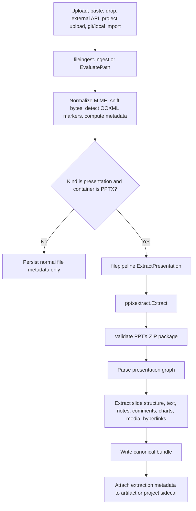
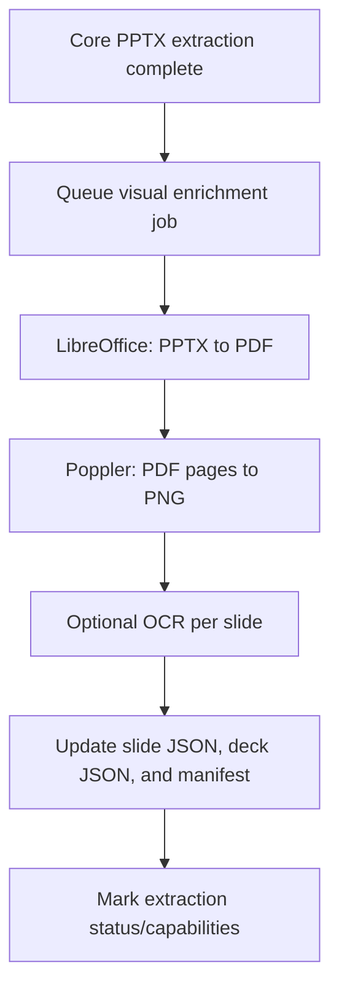

# PowerPoint File Extraction Pipeline

## Purpose

PowerPoint files are ingested through the same file entry point as every other uploaded or imported file, then evaluated before any presentation-specific processing happens. The pipeline is intentionally provider agnostic: it produces canonical local artifacts that can later be consumed by Anthropic, Anthropic Bedrock, OpenAI-compatible providers, Gemini, or local tools without requiring any provider to understand raw `.pptx` bytes.

This document describes the current pipeline implemented in:

- `server/internal/chat/fileingest`
- `server/internal/chat/filepipeline`
- `server/internal/chat/pptxextract`
- `server/internal/chat/httpapi/thread_attachments.go`
- `server/internal/chat/publicapi/attachments.go`
- `server/internal/chat/httpapi/handler.go`
- `server/internal/chat/httpapi/project_git.go`

The current implementation stops at extraction and metadata. It does not wire extracted files into LLM prompts, tools, or provider-specific document blocks.

## Design Principles

1. Every file hits `fileingest.Ingest` or `fileingest.EvaluatePath` first.
2. File type evaluation happens before typed processing.
3. PPTX handling is local and provider agnostic.
4. Provider adapters and tools do not import the extraction pipeline.
5. The original file is preserved exactly as uploaded or imported.
6. Extracted content is written as a canonical sidecar bundle with stable metadata.
7. Heavy visual stages are optional and should be async before being enabled in production upload paths.

## Entry Points

| Entry point | Route or call site | First file step | PPTX extraction output |
| --- | --- | --- | --- |
| Chat UI upload, paste, drop | `POST /api/threads/{threadId}/attachments` | `fileingest.Ingest` | `thread_uploads/{threadId}/{artifactId}.extract/` |
| External API attachment upload | `POST /api/external/v1/threads/{threadId}/attachments` | `fileingest.Ingest` | `thread_uploads/{threadId}/{artifactId}.extract/` |
| Project file upload | `PUT /api/projects/{projectId}/files?path=...` | `fileingest.Ingest` | `projects/{projectId}/file_extractions/{key}/` |
| Project finalize, refresh, git import, local import | `refreshProjectFileIndex` | `fileingest.EvaluatePath` | `projects/{projectId}/file_extractions/{key}/` |

`{key}` for project files is `pptxextract.ProjectExtractionKey(relPath)`, a deterministic hash prefix of the project-relative path. This keeps extraction directories stable across project refreshes without leaking path characters into directory names.

## High-Level Flow



## Stage 1: Generic File Ingest

All direct upload routes use `fileingest.Ingest`.

The generic ingest step:

1. Sanitizes the filename with `fileingest.SafeFileName`.
2. Streams the request body to a temporary file under the final storage directory.
3. Enforces the route-specific max file size.
4. Computes SHA-256 while streaming.
5. Captures a bounded preview buffer.
6. Atomically renames the temp file to its final path.
7. Evaluates the file using `fileingest.Evaluate`.

Project refresh paths use `fileingest.EvaluatePath`, because the file already exists in the project file tree.

## Stage 2: File Evaluation

`fileingest.Evaluate` derives:

- `fileName`
- `extension`
- `declaredMimeType`
- `extensionMimeType`
- `sniffedMimeType`
- `normalizedMimeType`
- `fileKind`
- `containerFormat`
- `sha256`
- text preview fields
- language hints
- capability flags

PPTX detection does not rely on the extension alone. `fileingest` opens the file as a ZIP/OOXML container and checks for markers such as:

- `[Content_Types].xml`
- `ppt/presentation.xml`

For PPTX, evaluation should produce:

```json
{
  "fileKind": "presentation",
  "containerFormat": "pptx",
  "normalizedMimeType": "application/vnd.openxmlformats-officedocument.presentationml.presentation",
  "ooxmlContainer": true
}
```

## Stage 3: Presentation Routing

`filepipeline.ShouldExtractPresentation` returns true only when:

- `fileKind == "presentation"`, and
- `containerFormat == "pptx"` or the normalized MIME is the PPTX MIME.

The routing helper is `filepipeline.ExtractPresentation`. It receives:

- original source path
- extraction output directory
- extraction output relative path
- original filename
- `fileingest.Evaluation`
- raw XML copy preference
- external stage preference

Current route wiring passes `EnableExternalTools: false`. That means extraction uses deterministic local OOXML parsing and native Markdown generation, but does not block uploads on MarkItDown, LibreOffice, Poppler, or OCR binaries.

## Stage 4: PPTX Package Validation

`pptxextract.Extract` starts by opening the `.pptx` as a ZIP package.

Validation checks:

- ZIP can be opened.
- Entry paths are safe:
  - no absolute paths
  - no `..` traversal
  - no null bytes
  - no Windows drive-style paths
- Entry count is below `DefaultMaxEntries`.
- Total uncompressed size is below `DefaultMaxUncompressedSize`.
- `[Content_Types].xml` exists.
- `ppt/presentation.xml` exists.

Current defaults:

```text
DefaultMaxEntries          = 4000
DefaultMaxUncompressedSize = 768 MiB
DefaultExternalTimeout     = 90 seconds
```

If validation fails, the extractor writes a failed manifest when possible and returns failed extraction metadata. The original uploaded file remains stored.

## Stage 5: Content Type Index

The extractor parses `[Content_Types].xml` into:

- default content types by extension
- override content types by package part

This is used to label extracted media and preserve package part provenance.

Example output in `deck_graph.json`:

```json
{
  "contentTypes": [
    {
      "part": "ppt/slides/slide1.xml",
      "contentType": "application/vnd.openxmlformats-officedocument.presentationml.slide+xml"
    }
  ]
}
```

## Stage 6: Presentation Graph Extraction

The extractor parses:

- `ppt/presentation.xml`
- `ppt/_rels/presentation.xml.rels`

It builds the ordered slide list from `<p:sldIdLst>`, preserving:

- slide number
- PowerPoint slide ID
- relationship ID
- hidden slide flag
- slide XML path

Relationships are resolved relative to the source package part. For example:

```text
ppt/presentation.xml + slides/slide1.xml
=> ppt/slides/slide1.xml
```

The graph is written to `deck_graph.json`.

## Stage 7: Per-Slide Structural Extraction

For each slide, the extractor reads:

- `ppt/slides/slideN.xml`
- `ppt/slides/_rels/slideN.xml.rels`

It extracts text from shape-like XML nodes:

- `sp`
- `pic`
- `graphicFrame`
- `cxnSp`

For each text block, the extractor preserves:

- text
- source type
- XML path
- shape ID
- shape name
- shape description / alt text when present
- placeholder type
- bounding box when present
- confidence score

Example text block:

```json
{
  "text": "Pipeline Review",
  "source": "shape",
  "xmlPath": "ppt/slides/slide1.xml",
  "shapeId": "2",
  "shapeName": "Title 1",
  "placeholderType": "title",
  "confidence": 0.99
}
```

## Stage 8: Notes, Comments, Charts, Media, and Links

Slide relationships are inspected for known target types.

### Speaker Notes

Relationship type containing `/notesSlide` is resolved and text is extracted from the notes slide XML.

Output location:

- `deck.json`
- `slides/slide-00N.json`
- `deck.md`

### Comments

Relationship type containing `/comments` is resolved and parsed into comment records.

The parser supports common comment text nodes and falls back to generic text extraction where possible.

### Charts

Relationship type containing `/chart` is resolved into a `Chart` record.

The extractor reads chart XML and captures:

- chart path
- title or first chart text
- chart text
- series names
- categories
- values
- embedded workbook relationship path when present

Example chart series:

```json
{
  "name": "Revenue",
  "categories": ["Q1"],
  "values": ["42"]
}
```

### Media

Image relationships and image-like target paths become `MediaRef` records.

Each media record includes:

- relationship ID
- package path
- content type if known

### Hyperlinks

External hyperlink relationships become `Hyperlink` records.

Each hyperlink includes:

- relationship ID
- target URL
- external flag

## Stage 9: Canonical Outputs

Every successful extraction writes this core bundle:

```text
manifest.json
deck.json
deck_graph.json
deck.md
slides/
  slide-001.json
  slide-002.json
  ...
```

Thread and external API uploads currently also write:

```text
raw/
  ooxml/
    [Content_Types].xml
    ppt/
      presentation.xml
      _rels/presentation.xml.rels
      slides/...
      notesSlides/...
      charts/...
```

Project extraction currently uses `IncludeRawXML: false` to avoid duplicating large project file trees during refresh/index operations.

## Canonical Bundle Files

### `manifest.json`

The manifest is the top-level extraction report.

Important fields:

```json
{
  "version": 1,
  "pipeline": "pptx",
  "status": "complete",
  "fileName": "pipeline.pptx",
  "sourceSha256": "...",
  "slideCount": 1,
  "outputs": {
    "deckPath": "deck.json",
    "graphPath": "deck_graph.json",
    "markdownPath": "deck.md",
    "slidePaths": ["slides/slide-001.json"],
    "rawOOXMLRoot": "raw/ooxml",
    "manifestPath": "manifest.json"
  },
  "capabilities": {
    "hasStructuredText": true,
    "hasMarkdown": true,
    "hasSlideJSON": true,
    "hasNotes": true,
    "hasComments": false,
    "hasCharts": true,
    "hasMedia": false,
    "hasRenderedSlides": false,
    "hasOCR": false
  },
  "stages": []
}
```

### `deck_graph.json`

`deck_graph.json` is the package graph. It should be used when a consumer needs relationship-level provenance.

It contains:

- ordered slides
- slide relationship IDs
- slide XML paths
- hidden flags
- layout paths
- notes paths
- comment paths
- chart paths
- media paths
- hyperlinks
- all slide relationships
- content type overrides

### `deck.json`

`deck.json` is the canonical structured content view.

It contains:

- file name
- slide count
- all slide records
- title guess per slide
- structured text blocks
- notes
- comments
- charts
- media
- hyperlinks
- rendered image paths if enabled
- OCR text if enabled
- aggregate plain text

### `deck.md`

`deck.md` is the readable Markdown view for later LLM context assembly or user preview.

It is generated from `deck.json`, not from a provider.

Current sections per slide:

- slide heading
- source XML path
- text
- speaker notes
- comments
- charts
- media
- OCR text when available

### `slides/slide-00N.json`

Per-slide JSON mirrors each slide object from `deck.json`. This supports later retrieval of only relevant slides rather than loading the whole deck.

## Extraction Metadata Contract

When PPTX extraction runs, the file evaluation metadata receives an `extraction` object.

Thread and external API attachment artifacts store this under:

```text
artifact.metadata.extraction
```

Project upload responses include it under:

```text
response.evaluation.extraction
```

Project refresh writes it under:

```text
projects/{projectId}/file_evaluations.json
  files[].evaluation.extraction
```

Shape:

```json
{
  "kind": "presentation",
  "pipeline": "pptx",
  "version": 1,
  "status": "complete",
  "slideCount": 1,
  "rootPath": "thread_uploads/thread_123/artifact_456.extract",
  "manifestPath": "thread_uploads/thread_123/artifact_456.extract/manifest.json",
  "deckPath": "thread_uploads/thread_123/artifact_456.extract/deck.json",
  "graphPath": "thread_uploads/thread_123/artifact_456.extract/deck_graph.json",
  "markdownPath": "thread_uploads/thread_123/artifact_456.extract/deck.md",
  "sourceSha256": "...",
  "capabilities": {},
  "outputs": {},
  "stages": []
}
```

Status values:

- `complete`: core extraction succeeded.
- `partial`: core extraction succeeded but one or more optional stages failed.
- `failed`: extraction failed.

## Optional External Stages

The extractor implements optional hooks for:

1. MarkItDown Markdown extraction.
2. LibreOffice and Poppler rendering.
3. Tesseract OCR.

These are controlled by:

```go
pptxextract.Request{
    EnableMarkItDown: true,
    EnableRendering:  true,
    EnableOCR:        true,
}
```

`filepipeline.ExtractPresentation` exposes these as:

```go
PresentationExtractionRequest{
    EnableExternalTools: true,
}
```

Current upload and project routes pass `EnableExternalTools: false`.

Reason:

- upload routes should not block on local binary availability
- rendering large decks can be slow
- OCR can be expensive and noisy
- project refresh may process many files

Recommended future behavior is an async extraction worker that starts with the deterministic OOXML bundle, then enriches it later with rendered slide images and OCR text.

## Future Async Visual Stage

The intended future visual pipeline is:



Expected future outputs:

```text
rendered/
  slide-001.png
  slide-002.png
ocr/
  slide-001.txt
  slide-002.txt
deck.markitdown.md
```

Visual outputs should update:

- `manifest.capabilities.hasRenderedSlides`
- `manifest.capabilities.hasOCR`
- `deck.slides[].renderPath`
- `deck.slides[].ocrText`

## Provider Boundary

The extraction pipeline is intentionally upstream of providers.

Provider adapters should not:

- open `.pptx` files directly
- parse OOXML
- depend on Anthropic Skills
- depend on Anthropic code execution
- decide file type from extension or MIME alone

Provider adapters may later consume selected extracted artifacts, such as:

- `deck.md`
- specific `slides/slide-00N.json`
- rendered slide images
- OCR snippets
- chart data from `deck.json`

This matters for Anthropic Bedrock. Direct Anthropic can optionally use hosted Skills/code execution, but Bedrock does not have the same hosted Skills/code execution surface. The local extraction bundle keeps both providers on the same file-understanding path.

## Failure Behavior

Failure to extract a PPTX must not delete or mutate the original file.

Expected behavior:

1. Original file remains stored.
2. Generic file evaluation remains available.
3. Extraction metadata is present with `status: "failed"` when the file was routed as PPTX but extraction failed.
4. Downstream code can decide whether to:
   - show a partial/failed extraction state
   - retry extraction
   - fall back to generic attachment handling

Example failed metadata:

```json
{
  "kind": "presentation",
  "pipeline": "pptx",
  "version": 1,
  "status": "failed",
  "error": "pptx missing ppt/presentation.xml"
}
```

## Security Notes

The pipeline treats `.pptx` as an untrusted ZIP package.

Current protections:

- safe filename normalization at upload entry
- atomic temp-file write before final storage
- upload max byte limits
- ZIP path traversal rejection
- ZIP entry count limit
- ZIP uncompressed size limit
- required OOXML marker validation
- no provider-executed code
- no macro execution
- no LibreOffice execution in synchronous upload route

When enabling async rendering:

- run renderer/OCR with timeouts
- use isolated worker directories
- keep render output under the extraction root
- preserve the original file unchanged
- record command failures as partial extraction, not upload failure

## Current Test Coverage

Core extractor tests:

- `server/internal/chat/pptxextract/extract_test.go`
  - canonical bundle creation
  - slide text extraction
  - notes extraction
  - chart series extraction
  - embedded workbook relationship detection
  - media and hyperlink relationships
  - unsafe ZIP entry rejection

HTTP route tests:

- `server/internal/chat/httpapi/thread_attachments_test.go`
  - PPTX upload creates extraction metadata and Markdown output.

- `server/internal/chat/httpapi/handler_upload_test.go`
  - project PPTX upload returns extraction metadata.
  - project refresh writes extraction metadata into `file_evaluations.json`.

Regression verification:

```bash
cd server
go test ./internal/chat/...

cd ..
npm run build
```

## Current Limitations

The current pipeline is reliable for deterministic OOXML extraction, but it is not yet a complete visual understanding system.

Known gaps:

- rendered slide images are implemented but not enabled in upload routes
- OCR is implemented but not enabled in upload routes
- MarkItDown is implemented as an optional stage but not enabled in upload routes
- chart extraction captures common cached values but is not a full chart semantic model
- SmartArt and complex grouped shapes may be represented as extracted text blocks rather than rich semantic objects
- comments depend on relationship shape and may need additional samples from real decks
- encrypted/protected decks fail extraction instead of being decrypted
- legacy `.ppt` and macro-enabled `.pptm` are not handled by this PPTX pipeline

## Implementation Checklist For Future Changes

When modifying this pipeline:

1. Keep all new file paths routed through `fileingest` first.
2. Do not add provider imports to `fileingest`, `filepipeline`, or `pptxextract`.
3. Do not add `pptxextract` imports to provider adapters or tools.
4. Preserve original files byte-for-byte.
5. Update `manifest.json` and `deck.json` schema intentionally.
6. Add tests with synthetic PPTX fixtures when changing extraction behavior.
7. Add route tests when changing metadata shape.
8. Run `go test ./internal/chat/...`.
9. Run `npm run build` if API response shapes or frontend metadata handling changes.

