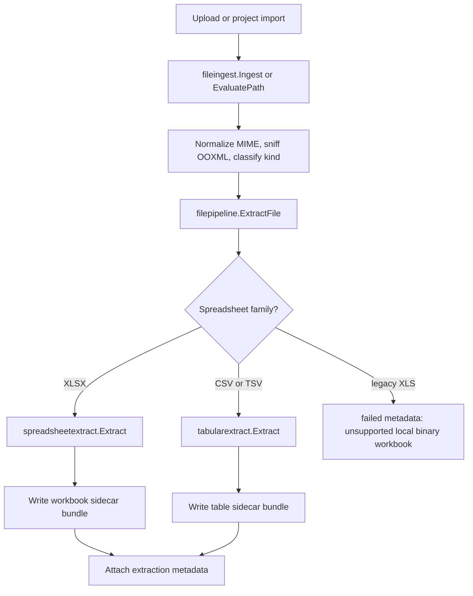

# Spreadsheet File Extraction Pipeline

## Purpose

Spreadsheet files enter the same file pipeline as every other upload or project file. They are evaluated by `fileingest` first, then routed by `filepipeline.ExtractFile` into a local, provider-agnostic extraction path.

The implementation covers:

- `.xlsx` workbooks through local OOXML parsing.
- `.csv` and `.tsv` files through a delimited-table parser.
- legacy `.xls` through explicit failed metadata, because binary BIFF parsing/conversion is not enabled in the default local path.

The pipeline is implemented in:

- `server/internal/chat/fileingest`
- `server/internal/chat/filepipeline`
- `server/internal/chat/spreadsheetextract`
- `server/internal/chat/tabularextract`

## Research Basis

The local XLSX path follows the Office Open XML model: workbooks are ZIP packages containing XML parts, relationships, sheets, styles, shared strings, tables, charts, comments, and media. Microsoft documents Word/Office Open XML as structured package parts; the same Open Packaging Convention approach applies across DOCX, PPTX, and XLSX.

For LLM reliability, the app should not depend on provider-specific spreadsheet interpretation. Anthropic Skills/code execution may work in direct Anthropic paths, but Bedrock and other providers do not expose the same runtime. The reliable baseline is therefore local extraction into sidecars that every provider can inspect through tools.

## Routing



## XLSX Pipeline

`spreadsheetextract.Extract` performs:

1. ZIP safety validation:
   - rejects unsafe paths
   - caps entry count
   - caps total uncompressed size
   - requires `[Content_Types].xml`
   - requires `xl/workbook.xml`

2. Workbook graph parsing:
   - sheet order, names, IDs, visibility
   - workbook relationships
   - defined names
   - date system and calculation mode

3. Shared workbook resources:
   - shared strings
   - styles and number formats
   - security flags
   - external links

4. Per-sheet extraction:
   - dimensions
   - cells as JSONL
   - display values
   - formulas and cached values
   - comments
   - hyperlinks
   - merged ranges
   - hidden rows/columns
   - tables
   - charts and media inventory

5. Output bundle writing.

## XLSX Outputs

Typical output root:

```text
thread_uploads/{threadId}/{artifactId}.extract/
projects/{projectId}/file_extractions/{key}/
```

Bundle:

```text
manifest.json
workbook.json
workbook_graph.json
styles.json
shared_strings.summary.json
defined_names.json
external_links.json
security.json
index/workbook.md
worksheets/{sheet_id}/sheet.json
worksheets/{sheet_id}/cells-0001.jsonl
worksheets/{sheet_id}/preview.md
worksheets/{sheet_id}/merged_cells.json
worksheets/{sheet_id}/comments.jsonl
tables/{table_id}/table.json
tables/{table_id}/rows-0001.jsonl
formulas/formulas.jsonl
charts/{chart_id}.json
media/media_manifest.json
raw/ooxml/...        optional for thread uploads
```

Artifact metadata includes:

- `kind: "spreadsheet"`
- `pipeline: "xlsx"`
- `manifestPath`
- `workbookPath`
- `graphPath`
- `markdownPath`
- `dataPath`
- sheet/table/formula/comment/chart/media counts
- hidden sheet and hidden row/column flags
- external-link and macro/OLE flags
- cached value policy
- capabilities and warnings

## CSV/TSV Pipeline

`tabularextract.Extract` is intentionally simpler:

1. Read a bounded sample.
2. Detect delimiter for CSV-like files; force tab for TSV.
3. Strip UTF-8 BOM.
4. Parse with Go's CSV reader in forgiving mode.
5. Treat the first row as headers.
6. Normalize duplicate/blank headers.
7. Emit row objects as JSONL.
8. Infer column types and sample values.
9. Detect spreadsheet formula-injection risk in cells beginning with `=`, `+`, `-`, or `@`.

Outputs:

```text
manifest.json
table.json
schema.json
rows-0001.jsonl
preview.md
```

## Attachment Inspection

`inspect_attachment` returns compact extraction metadata. `read_attachment` and `search_attachment` now use extraction sidecars for non-text spreadsheet attachments. For XLSX this means model access goes through `index/workbook.md` and searchable JSON/JSONL sidecars instead of raw ZIP bytes.

## Legacy XLS

`.xls` currently returns failed extraction metadata:

```json
{
  "kind": "spreadsheet",
  "pipeline": "xls",
  "status": "failed",
  "error": "legacy .xls binary workbook extraction is not supported by the local file pipeline"
}
```

The recommended future upgrade is an optional conversion stage behind the existing `EnableExternalTools` request flag, not an environment variable. LibreOffice conversion to XLSX, followed by the same XLSX pipeline, is the preferred local path when external tools are allowed.

## Verification

Focused coverage exists in:

- `server/internal/chat/filepipeline/spreadsheet_test.go`
- `server/internal/chat/httpapi/spreadsheet_pipeline_test.go`
- `server/internal/chat/tools/thread_attachment_tools_test.go`

The covered cases include XLSX upload metadata, project sidecar metadata, CSV, TSV, delimiter sniffing, unsupported XLS metadata, and binary spreadsheet attachment read/search through extraction outputs.
